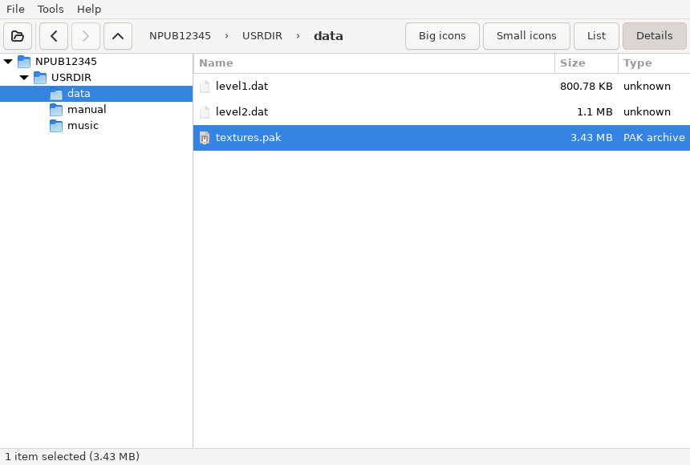

# PkgView (Rust/GTK4 port)

Browse and extract Sony **PS3/PSP `.pkg`** installation packages on Linux, with GNOME Files integration.
**PS4** packages can be looked at and verified, but not unpacked (see [PS4 packages](#ps4-packages)).
This is a Rust/GTK 4 port of [PkgView 1.3](https://github.com/ifcaro/PkgView) (VB.NET/WinForms, 2010–2012), written by
**[Ifcaro](https://github.com/ifcaro)**. All credit for working out the package format and writing the original tool
goes to him; see [Credits](#credits).



- Folder tree + file list (big icons / small icons / list / details), right-click extract (in the tree, the
  folder under the pointer)
- Details columns: Name, Size, Type, plus Offset, Key (PS3/PSP/Debug) and Flags (right-click the header);
  click a header to sort, folders stay first; visible columns are remembered
- **Search** (Ctrl+F): substring of the path, or `*`/`?` wildcards; results list every folder, double-click
  jumps to the file (selected and scrolled into view)
- Path bar with Back / Forward / Up (Alt+←/→/↑, Backspace); keyboard shortcuts under Help → Keyboard Shortcuts
- **Open a file** (double-click / Enter) with its default application, and **drag files out** to a file manager.
  Both extract to `~/.cache/pkgview/open/<pid>/` first, which is deleted the next time PkgView starts (not at
  exit: an image viewer may still be reading the file). Drag-out is capped at 512 MB: GTK 4 has no way to let the drop target
  choose the destination, so the files are extracted when the drag starts.
- Open Recent + a welcome page; drop one `.pkg` to open it, or several / a folder to bulk-extract them
- **Extract dialog** (Ctrl+E): destination (typed, browsed or one of the last 8), create a folder named after the
  package, keep the folder structure or flatten, open the destination when done, and what to do with existing
  files: **Ask** (Skip / Skip All / Keep Both / Replace / Replace All), Skip, Replace, or Keep both (`name (1).ext`).
  The choices are remembered. *Extract to source folder* and the Files menu's *Extract Here* keep the original
  layout but use the remembered overwrite rule. Extraction stops before writing anything if the destination
  lacks the space.
- **Never writes through a symlink** below the destination: a symlinked folder in the way is an error, a
  symlinked file is replaced by the real file (its target is untouched).
- **Bulk extract** (File → Bulk extract to…): pick several `.pkg` files, then the same Extract dialog; each goes
  to `<dest>/<pkg name>/` with its own log. A broken package is reported at the end and doesn't stop the rest.
- Debug and retail packages, PS3 and PSP keys
- **Inspector** (F9, the button at the right of the toolbar): select one file to preview it (images, PARAM.SFO
  as a table, text, or a hex dump of the first 4 KB) with its size, key, offset and flags; with nothing (or several
  things) selected it shows the package: icon, title, every PARAM.SFO key and the **package metadata** (content
  type such as Game / PS1 Classic / Theme, DRM type, flags such as "requires licence", package and app version,
  required system software, install folder). Reading happens off the UI thread.
- Properties: header fields, content ID, QA digest, SHA-1, PARAM.SFO title info, ICON0.PNG. **Verify** checks
  the SHA-1 and that every file of a known kind (PARAM.SFO, PNG, EBOOT.BIN/SELF/SPRX, PBP, EDAT/SDAT) decrypts to
  its header, which catches a wrong key
- **Library** (File → Open Library Folder…, Ctrl+L, or `pkgview --library DIR`): every package in a folder as a
  table with icon, title, Title ID, kind (Game, Patch, PS1 Classic, Add-on…), version, size, status, licence and
  notes; sort, filter, double-click to open. **Verify** checks every SHA-1 (4 at a time; results survive renames).
  The notes say what needs attention: cut-off downloads, damaged packages (and where an intact copy is),
  identical copies, a patch or add-on whose game isn't in the folder (patches for disc games, Title ID `B…`, are
  not flagged), and a package that needs a licence with no `<content ID>.rap` next to it or in RPCS3.
- **Rename** (Library → Rename…, or `pkgview rename`): readable names from a template such as
  `{TITLE} [{TITLE_ID}] [v{APP_VER}] [{CATEGORY}]`, shown before anything changes; safe on FAT/exFAT/NTFS drives,
  never overwrites, and every run can be undone (Undo Rename / `pkgview rename --undo`).
- Bulk extract failures list each package with its reason and offer **Retry Failed**.
- **Install to RPCS3** (Tools menu, the library, or `pkgview install-rpcs3`): puts a package into the emulator's
  `dev_hdd0` the way RPCS3's own installer does (see below), with progress and cancel; a `.rap` licence next to
  the package is copied too. RPCS3 is found from its own config (native or Flatpak); if it can't be, PkgView
  asks for the `dev_hdd0` folder once.
- **DAT check** (Library → DAT…, `pkgview audit --dat FILE`, or `pkgview --library DIR --dat FILE`): looks every
  package up in a No-Intro or Redump DAT (Logiqx XML) by the SHA-1 of the whole file: *matches the DAT: <name>*,
  *not in the DAT*, or *the DAT lists this file name with another SHA-1*.
- **Compare two packages** (`pkgview diff A.pkg B.pkg`): entries added, removed or changed (size, flags, and
  with `--content` the bytes), e.g. what an update patch replaces.
- GNOME Files: package icons as thumbnails; right-click *Extract Here* / *Extract To…* / *Open with PkgView*;
  **Game Title, Title ID, Package Kind and Package Version columns** and a **PkgView section in Properties**
- Headless CLI (`info`, `list`, `cat`, `extract`, `verify`, `audit`, `rename`, each with several packages;
  `--json` for scripts),
  man page, bash/zsh/fish completions; `.deb`, `.rpm` and Arch packages

Requirements and roadmap: [PRD.md](PRD.md).

## Install

Download the package for your distro from the
[latest release](https://github.com/Stolly345/pkgview/releases/latest):

| Distro | Install |
|---|---|
| Ubuntu 24.04+, Debian 13 | `sudo apt install ./pkgview_2.7.0-1_amd64.deb` (use `apt`, not `dpkg -i`, so dependencies come too) |
| Fedora 40+ | `sudo dnf install ./pkgview-2.7.0-1.x86_64.rpm` |
| openSUSE Tumbleweed | `sudo zypper install --allow-unsigned-rpm ./pkgview-2.7.0-1.x86_64.rpm` |
| Arch | `sudo pacman -S --needed git base-devel && git clone https://github.com/Stolly345/pkgview && cd pkgview/packaging/aur && makepkg -si` |

All four are tested installing and running in clean containers.

Then restart Files (`nautilus -q`) so it loads the right-click menu. Needs GTK ≥ 4.14 and glibc ≥ 2.39; on
Debian 12 build 2.3.1 (commit `4bfd30c`, the last version for GTK 4.8) from source. The Files menu needs the Nautilus Python bindings (`python3-nautilus`,
`nautilus-python`, `python3XX-nautilus`), installed with the package unless you skip recommended packages.

- **Arch and Arch-based:** the PKGBUILD in `packaging/aur` (`pkgview-bin`) repackages the release `.deb`, so
  nothing compiles. It isn't on the AUR yet (AUR registration is closed for now):

  ```sh
  sudo pacman -S --needed git base-devel
  git clone --depth 1 https://github.com/Stolly345/pkgview && cd pkgview/packaging/aur
  makepkg -si
  sudo pacman -S --needed python-nautilus   # optional: the Files right-click menu
  ```

  Remove with `sudo pacman -R pkgview-bin`.

## Build

The host only needs Docker: everything builds in an Ubuntu 24.04 container (`Dockerfile.build`). Ubuntu 24.04 is
the oldest target (GTK 4.14, glibc 2.39), so the binary's requirements are met there and on Debian 13 and newer.

```sh
make image    # once: Ubuntu 24.04 + rustup + libgtk-4-dev + cargo-deb (+ Xvfb tools for `make gui`)
make test     # unit tests
make lint     # rustfmt + clippy -D warnings
make deb      # → target/debian/pkgview_<ver>-1_amd64.deb
make rpm      # → target/generate-rpm/pkgview-<ver>-1.x86_64.rpm (same binary; after make deb)
make arch     # PKGBUILD pkgver/sha256 from the .deb, makepkg + namcap + install in archlinux, .SRCINFO
make packages # all three
make install  # deb + apt install
make sample TYPE=0x80000002   # write a synthetic sample.pkg to play with
make realtest SAMPLES=~/pkgs  # real pkgs (mounted read-only): SHA-1, PARAM.SFO, full extract to a temp dir
make compare [SAMPLES=~/pkgs] # byte-compare with the original VB code (see Verification status)
make gui      # drive the GUI under Xvfb, screenshots in target/gui/ (look at them)
```
With a local toolchain (`rustup`, `libgtk-4-dev`, `cargo install cargo-deb cargo-generate-rpm`) use `make deb RUN=`.

**Release checklist:** `make test lint gui packages`; install the `.deb` in `ubuntu:24.04` and `debian:13`, the
`.rpm` in `fedora:43` and `opensuse/tumbleweed` (each runs `pkgview --version` + `verify`); `dpkg-deb -f … Maintainer`
shows the no-reply address; upload exactly the `.deb` and `.rpm` from `target/` (the PKGBUILD pins the `.deb`'s
SHA-256) and commit `packaging/aur/PKGBUILD` + `.SRCINFO`.

## Usage

```
pkgview [FILE.pkg]                     # GUI
pkgview info FILE.pkg…                 # header, package metadata, every PARAM.SFO key
pkgview list FILE.pkg…                 # flags, size, path
pkgview cat FILE.pkg PATH              # one file to stdout (e.g. `pkgview cat x.pkg PARAM.SFO | xxd`)
pkgview extract FILE.pkg… [-o DIR]     # all, into DIR/<pkg name>/ (default DIR: next to each pkg)
pkgview extract FILE.pkg -o DIR PATH…  # only these files/folders (paths as shown by `list`, without the root)
        [--overwrite skip|replace|rename] [--no-pkg-folder] [--flat]
pkgview verify FILE.pkg…               # trailing SHA-1 + known-file headers (wrong-key check)
pkgview info|list|verify --json FILE…  # one JSON object per package per line (JSON Lines)
pkgview audit FILE|DIR… [--no-hash] [--json]   # check a collection (see Library)
pkgview rename FILE|DIR… [-t TEMPLATE] [-n]    # rename by template; -n = dry run
pkgview rename --undo                  # reverse the last rename run
pkgview --library DIR [--dat FILE]     # GUI: open DIR in the library window (and check it against a DAT)
pkgview install-rpcs3 FILE… [--hdd0 DIR] [--user ID]   # install into RPCS3 like RPCS3 does
pkgview diff A.pkg B.pkg [--content] [--json]           # exit 0 = same, 1 = different
pkgview audit … --dat FILE             # also match against a No-Intro / Redump DAT
pkgview -ex FILE.pkg                   # original PkgView's "extract here" switch
pkgview --extract-here FILE.pkg…       # GUI progress window only, next to each file
pkgview --extract-to FILE.pkg…         # GUI: the Extract dialog, then progress window only
```
`extract` arguments after the first that end in `.pkg` are more packages; anything else is an inner PATH (only
with one package). Several packages are processed one after another; a failure is reported and the rest still
run. **Exit status: 0** = all OK, **1** = at least one package or entry failed (the count is printed),
**2** = usage error. `--overwrite` defaults to `replace`, the original's behaviour.

`audit` prints one line per package (status, kind, Title ID, version, title, file) with notes under it and a
summary, and exits 1 if any package is damaged, cut off or unreadable (duplicates and missing games are
reported, not failures). `--no-hash` skips the SHA-1 check (instant). `rename` fields: `{TITLE}` `{TITLE_ID}`
`{CONTENT_ID}` `{APP_VER}` `{VERSION}` `{CATEGORY}` `{KIND}` `{REGION}`; a `[…]` group is left out when a field
in it is empty; `: / \ | * ? " < >` are replaced or dropped; a name already taken gets ` (1)`. Each run is
logged in `~/.local/state/pkgview/renames/` before the next file is touched, so `--undo` can reverse it (newest
first; a name taken again meanwhile is reported and skipped).

`--json` prints one compact object per package and line, so a single package is plain JSON and several are JSON
Lines (`pkgview info --json *.pkg | jq -r 'select(.metadata.content_type_name == "PS1 Classic") | .file'`).
A package that can't be read prints `{"file": …, "error": …}` and still counts as failed. Fields: `info` has the
header fields, `metadata` (only the records present) and `sfo` (every key, values as strings); `list` has `root`
and `entries` (`path`, `dir`, `size`, `offset`, `flags`, `key`); `verify` has `ok`, `sha1_ok`, `headers_checked`,
`headers_wrong`.

Output layout matches the original: `DIR/<pkg name>/<root>/…` plus `DIR/<pkg name>/<pkg name>.log`
(`[HH:MM:SS] path size bytes OK|FAILED`, then `Extraction completed.` / `Extraction cancelled.`).
`<root>` is the content ID's middle part minus `_00`, e.g. `UP0001-NPUB12345_00-…` → `NPUB12345`.

Desktop integration (GNOME Files):
- Double-clicking a `.pkg` opens PkgView; *Tools → Associate .pkg files* makes it the default for the current user.
- **Thumbnails**: Files shows each package's `ICON0.PNG` (or `PIC1.PNG`) as its icon
  (`/usr/share/thumbnailers/pkgview.thumbnailer` → `pkgview thumbnail IN OUT SIZE`, no display needed).
- **Right-click menu**: *Extract Here*, *Extract To…* and *Open with PkgView* on `.pkg` files (all selected
  files must be packages). Needs `python3-nautilus` (a Recommends of the `.deb`) and a Files restart
  (`nautilus -q`). Remote files (sftp, smb) are skipped.
- **Columns** (list view → Visible Columns): *Game Title*, *Title ID*, *Package Kind*, *Package Version*; and a
  *PS3/PSP Package (PkgView)* section in a package's Properties. Values come from `pkgview info --json`, run in
  the background and cached per file, so Files never waits on a folder of packages. Checked in Nautilus 46
  (screenshots); the extension also loads under Nautilus 49's API 4.1.
- `pkgview --extract-here FILE…` / `--extract-to FILE…` show only a progress window (after a folder chooser
  for `--extract-to`) and an error dialog if a package fails; exit status 1 then. The launcher's "Extract here"
  action and *Open With → Extract PS3 PKG here* use `--extract-here`.
- `man pkgview`; bash, zsh and fish completions are installed with the package.

**How `install-rpcs3` installs** (from RPCS3's `rpcs3/Crypto/unpkg.cpp`): into `dev_hdd0/game/<install folder>/`,
where the install folder is the metadata's (DLC) or the 9 characters of the Title ID at header offset 55; themes
go to `theme/`, licences to `home/<user>/exdata/`, widgets, VSH modules, avatars and virtual memory cards to
their own folders. Entries of type `0x04`/`0x12` are folders; only the file types RPCS3 writes are written; a file
that already exists is replaced only if the package marks its entry overwritable (flag `0x80000000`), otherwise
kept (that's how RPCS3 keeps a game's files when a patch doesn't replace them); a new install folder is removed
again if the install fails or is cancelled. `dev_hdd0` comes from RPCS3's `vfs.yml` (`$(EmulatorDir)` = its
config folder), native install first, then Flatpak. **Compared with RPCS3 itself:**
`make compare-rpcs3` installs the test packages with RPCS3's own installer (`rpcs3 --installpkg`) and with
PkgView and compares the trees byte for byte. On 2026-11-01, with RPCS3 0.0.43-20550, the debug PS3, retail PS3
and PSP test games came out identical, and so did two real PSN packages (a 1.67 GB retail game, 89 files, and a
5 MB debug package for the same game). Not yet compared: DLC, patches over an installed game, PS1 Classics.
`RPCS3_APPIMAGE=path` uses a local AppImage instead of downloading the latest; `SAMPLES=dir` adds real packages.

## PKG format (as implemented by the original)

All integers are big-endian.

| Off | Size | Field (original PkgView name) |
|---|---|---|
| 0x00 | 4 | magic `7F 50 4B 47` |
| 0x04 | 4 | type: `0x00000001` debug PS3, `0x80000001` retail PS3, `0x00000002` debug PSP, `0x80000002` retail PSP |
| 0x08 | 4 | metadata offset ("Header size") |
| 0x0C | 4 | metadata count ("Unknown 1") |
| 0x10 | 4 | header size ("Section 2 offset") |
| 0x14 | 4 | item count |
| 0x18 | 8 | total size |
| 0x20 | 8 | data offset |
| 0x28 | 8 | data size |
| 0x30 | 48 | content ID |
| 0x60 | 16 | QA digest |
| 0x70 | 16 | data RIV (counter IV) |
| EOF−32 | 20 | SHA-1 |

**Metadata** (not encrypted) starts at the metadata offset: `metadata count` records of `id u32, size u32, data`.
Decoded as RPCS3's `package_reader::read_metadata` does: `0x1` DRM type, `0x2` content type, `0x3` package flags,
`0x4` package size, `0x5` package revision (last 2 bytes = version, BCD), `0x6` title ID, `0x8` software revision
(bytes 1–2 = required system software, 6–7 = app version, BCD), `0xA` install folder (after 8 bytes). Content
type and flag names are RPCS3's; DRM type names (1 Network, 2 Local, 3 Free) are shown as *unverified*. A
damaged block only leaves fields empty.

**Encryption** is a keystream XOR over 16-byte blocks; block *n* is at `data_offset + 16n`:
- retail: `AES-128-ECB(key, data_riv + n)` (a 128-bit big-endian counter, i.e. AES-CTR).
  PS3 key `2E7B71D7C9C9A14EA3221F188828B8F8`, PSP key `07F2C68290B50D2C33818D709B60E62B`
- debug: `SHA1(K + n)[0..16]`, where `K` is a 64-byte big-endian counter laid out as
  `qa[0..8] qa[0..8] qa[8..16] qa[8..16]` followed by 32 zero bytes

**Key choice:** debug pkgs always use the SHA-1 scheme. In retail pkgs, entries whose flags have upper byte `0x90` use the PSP key and all
others the PS3 key. The item table uses the header type's key. In retail PSP pkgs, the names of non-`0x90` entries
are PS3-key encrypted, so the table is decrypted twice, exactly as the original does it.

**Item table** at `data_offset`: `item_count` × 32-byte records `name_offset u32, name_size u32, data_offset u64,
size u64, flags u32, pad u32` (offsets relative to `data_offset`; flags low byte `0x04` = directory), then the names.
The first record's data offset is the size of the table plus the names.

## Differences from the original

- **Seeking is O(1).** The original stepped the counter block by block in a busy thread to reach a file.
- Names are read through `name_offset`. The original assumed names are packed and 16-aligned; tests check
  that both give the same result for packed pkgs. The item table is sized from where the names end; the original
  used the first entry's data offset, which a crafted pkg can point gigabytes away (found by the >4 GiB test).
- The last partial block is handled with `ceil(size/16)` blocks. The original used rounding division plus one
  extra block; it gives the same bytes, partly because `AESEngine` caches the first key until `free()`.
- Untrusted input is checked: `..`, absolute paths, NUL and `\` in names are rejected, every offset is
  bounds-checked against the file size, and `item_count` and the table size are capped before allocating.
- The pkg is opened read-only (the original used ReadWrite). A cancelled or failed file is deleted.
- In debug pkgs, `0x90` entries also use the SHA-1 scheme. The original ran the PSP AES key over the 64-byte debug key
  buffer there, so its output for those entries differs (confirmed by `tools/compare-with-original.sh`). **RPCS3
  agrees with the port**: its `rpcs3/Crypto/unpkg.cpp` (`package_reader::decrypt`) uses the SHA-1 keystream for
  every entry of a debug pkg and ignores the entry's key there (checked 2026-10-31).
- Known difference from RPCS3, kept to stay byte-identical with the original: RPCS3 picks the PSP key by flag bit
  `0x10000000`, the original (and the port) by top byte `== 0x90`; and RPCS3 decrypts the *names* of PSP entries
  with the PSP key in retail PS3 pkgs too, where the original uses the table's key. They agree on every package
  whose PSP entries are flagged `0x90…` (all samples so far). Revisit if a retail pkg with `0x10…`/`0x30…`
  entries, or garbled names, turns up.
- The dead "New / Save / Save as…" menu items are gone. "Associate" uses `xdg-mime` instead of the registry.
- The progress window does not lock the main window. The total progress bar is by bytes, not file count.
- The app ID / desktop file is `io.github.stolly345.pkgview(.desktop)`, not `pkgview.desktop`. A GTK app ID needs a dot,
  and on Wayland the desktop file name has to match the app ID for the window icon to show.
- Type 2 (debug PSP) is rejected, like the original.

## PS4 packages

PS4 packages (`\x7FCNT`) open **read-only**: the title, IDs, version and PARAM.SFO, the icon and background
images, and the other files the package stores unencrypted (`playgo-…`, `pronunciation.…`), shown under
`sce_sys/` as on an installed game. They can be extracted, previewed and searched like any other file.
**Verify** checks the package's three SHA-256 digests (the header up to `0xFE0`, the body, and the game image),
which together cover the whole file, so a damaged or cut-off download is caught without the download's `.json`.
`audit`, the library window, rename and `diff` include them; the kinds are *PS4 Game* (CATEGORY `gd`), *Patch*
(`gp`) and *Add-on* (`ac`).

What PkgView **can't** do with them: unpack the game itself, or install it anywhere. The game's files are in an
encrypted image whose key comes from a licence tied to the PS4 account that bought it; there is no shared key as
on the PS3. *Install to RPCS3* refuses PS4 packages (RPCS3 is a PS3 emulator).

Header layout (big-endian): `0x10` entry count, `0x18` entry table offset, `0x20`/`0x28` body offset/size,
`0x40` content ID, `0x70` DRM type, `0x74` content type, `0x160` body SHA-256, `0x410`/`0x418` game image
offset/size, `0x430` package size, `0x440` game image SHA-256, `0xFE0` header SHA-256. Entry records are 32 bytes:
`id, name offset, flags (bit 31 = encrypted), flags 2, offset, size` (u32 each), then 8 bytes of padding. File
names come from the package's own name table (entry `0x200`); entries without a name (keys, licence) aren't shown.
All of this was checked on a retail PSN package (P.T., EU): every offset, the three digests and the file list.

## Verification status

- **Checked against the original code:** `make compare` (`tools/compare-with-original.sh`) compiles the original
  `pkgmgr.vb` / `AESEngine.vb` / `Archivo.vb` under Mono, with two mechanical edits Mono needs (see the script),
  inside a headless harness that copies `Main.vb`'s `extractfile`. It extracts synthetic debug, retail-PS3 and
  retail-PSP pkgs with both implementations. Result: the original lists the same names, sizes and flags; **retail
  PS3 and retail PSP output is byte-identical**; debug differs only in the `0x90` entry (see above).
- **Real packages** (`make realtest`, `make compare SAMPLES=…`): 3 debug PS3 pkgs (PS1 Classics, 60–365 MB,
  16 entries each, metadata at `0xC0` and `0x280`). All three pass the SHA-1 check, their PARAM.SFO TITLE_ID
  matches the content ID, every entry extracts at its recorded size, and the original's code produces the same
  bytes. Since 2026-11-01 also two PSN packages of one game: a **retail** PS3 pkg (1.67 GB, 97 entries, 70+ EDAT
  files) and a debug one (6 entries), both with metadata. Both pass SHA-1 and the header check, and the original's
  code produces the same bytes. No PSP, >4 GB or split pkgs have been available.
- The other crypto and format tests in `src/pkg.rs` run against **synthetic** pkgs built by a test-only writer
  that uses the same keystream code. They catch regressions and bad bounds handling, not a misreading of the format.
  Exception: `entry_beyond_4gib` encrypts with an independent counter (u128 / RPCS3-style) and puts an entry
  4 GiB into a sparse file, for all three key types: no 32-bit offset or counter on the read path.
- **Header check magic bytes** (`verify`, Properties → Verify) were compared with the files of a real PS3 disc
  game folder: `PARAM.SFO` `\0PSF`, `ICON0/PIC1.PNG` `\x89PNG`, `EBOOT.BIN` and `.self` `SCE\0`; `.EDAT` `NPD\0` on the
  real retail package above. PBP/SDAT magics come from psdevwiki and are unconfirmed on a real file.
- **Verified:** the SHA-1 covers `[0, EOF−32)` (per psdevwiki); checked on the real packages above.
- **Verified:** PARAM.SFO layout (little-endian `\0PSF` header, 16-byte index entries); real SFOs parse.
- **Settled from source, not a sample:** key handling for `0x90` entries in debug pkgs matches RPCS3 (see Differences).
- **PS4 (2.8.0):** header, entry table, name table and all three digests checked on one retail PSN package
  (a full game, 1.35 GB); `pkgview verify` takes 3.4 s on it (file in page cache). The PS4 kinds `gp` (patch)
  and `ac` (add-on) are from documentation; only `gd` was seen on a real package.
- **Metadata decoding (2.5.0) checked on two real packages:** the package version, app version and required
  system software read from the metadata equal PARAM.SFO's VERSION, APP_VER and PS3_SYSTEM_VER, the package size
  equals the header's, and the content type (Game) matches CATEGORY HG. Still **unverified**: what the DRM type
  numbers mean (both had 3, shown as "Free"), and flag names other than the ones these packages carry.

## Performance

i7-1260P (16 threads), NVMe, file in page cache, 1 GiB entry: **retail 1.2 s** (AES-NI, about 870 MB/s,
I/O-bound); **debug 1.5–1.9 s** (one SHA-1 per 16-byte block, spread over all cores since 2.5.0; it was 7.2 s on
one core). `verify` hashes 1 GiB in 0.7 s.

## Legal

PkgView is not affiliated with or endorsed by Sony Interactive Entertainment. It contains no game content and
does not decrypt EDAT/RAP-protected files; it reads package containers using the package keys that the original
PkgView and other open-source tools have published since 2010. Only use it on packages you have the right to use.

## Credits

- **[Ifcaro](https://github.com/ifcaro)** (ifcaro@ifcaro.net) wrote the original **PkgView**, 2010–2012:
  [github.com/ifcaro/PkgView](https://github.com/ifcaro/PkgView), released under the ISC licence. This project is
  a port of that tool. Its package parsing, the decryption scheme, the debug/retail and PS3/PSP key handling, the
  extraction layout and the log format all follow his `pkgmgr.vb` and `Main.vb`, and his code is the reference
  that every release is compared against byte for byte (`make compare`). The PS3/PSP package keys used are the
  ones his tool published. His copyright notice is kept in `LICENSE`, in the About dialog and in every package.
- The format notes are cross-checked against the [PS3 Developer Wiki](https://www.psdevwiki.com/ps3/PKG_files)
  and [RPCS3](https://github.com/RPCS3/rpcs3) (`rpcs3/Crypto/unpkg.cpp`).
- Rust/GTK 4 port, Linux desktop integration and packaging: Alex Stoll (2026).

This port is not affiliated with Ifcaro, and he is not responsible for its bugs.

## License

ISC, the original's licence; see `LICENSE`. Original © 2010–2012 Ifcaro; Rust port © 2026 Alex Stoll, same terms.
